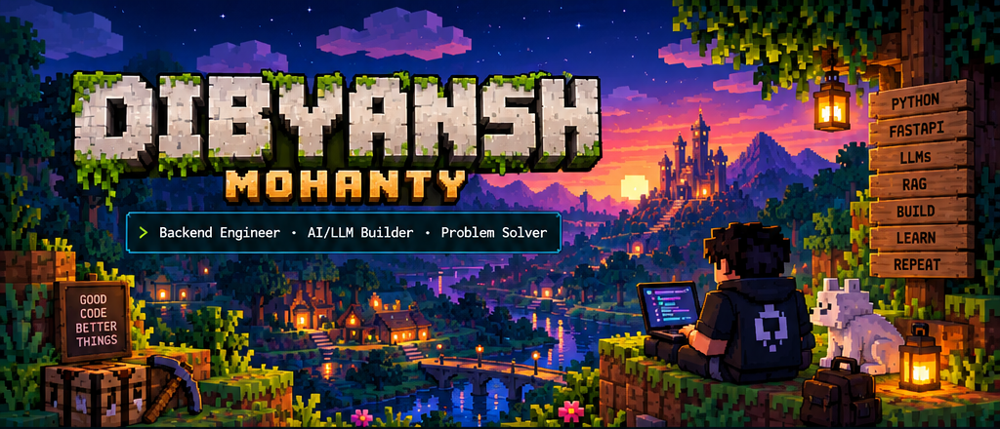

<!--
  DIBYansh / decoded15
  Minecraft Overworld • Backend Engineering • AI/LLMs
-->

<p align="center">
  
</p>

<h1 align="center">⛏️ Dibyansh Mohanty</h1>

<p align="center">
  <a href="https://github.com/decoded15">
    
  </a>
</p>

<p align="center">
  <code>~/overworld/developer</code> &nbsp; • &nbsp;
  <code>status: building</code> &nbsp; • &nbsp;
  <code>mode: creative</code>
</p>

---

## 🌿 `whoami`

<table>
<tr>
<td width="65%" valign="top">

### Hey, I'm Dibyansh! 👋

A Computer Science student who loves building things at the intersection of **backend development and AI**.

I work with Python, FastAPI and LLMs, and enjoy creating practical tools, RAG systems and automation projects.

Currently exploring better ways to build useful AI-powered applications.

```python
class Developer:
    name = "Dibyansh Mohanty"
    username = "decoded15"
    focus = ["Backend", "LLMs", "RAG"]
    toolkit = ["Python", "FastAPI", "AI"]

    def next_quest(self):
        return "Build something useful."
```

</td>
<td width="35%" valign="top">

### 🧭 Player profile

- 📍 Bhubaneswar, India
- 🎓 B.Tech CSE
- 🐍 Python backend
- ⚡ FastAPI
- 🧠 LLMs & RAG
- 🛠️ AI-powered tools
- 🌱 Always learning

<p>
  <a href="https://github.com/decoded15">
    
  </a>
</p>

</td>
</tr>
</table>

---
